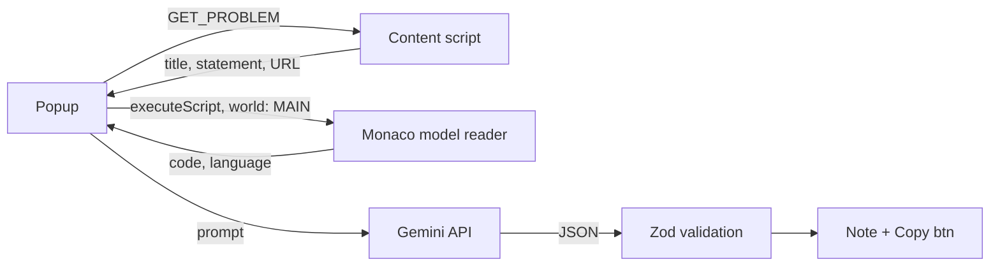

# LeetNote AI

Turn a solved LeetCode problem into Notion-ready Markdown notes with one click.


## Overview

After solving a LeetCode problem, writing structured notes by hand is slow. LeetNote AI is a Chrome extension that does it for you.

Open a problem, click the extension icon, then click **Generate Note**. The extension reads the problem and your current solution, asks Gemini for an analysis, and shows Markdown you can paste straight into Notion.

Version 1.0.0. It is a personal tool and a learning project. There is no backend.

## Features

- Auto-detects the problem title, statement and URL.
- Reads your solution from LeetCode's Monaco editor model, so long solutions are not truncated.
- Shows the detected title, language and line count before you generate anything.
- Returns an advisory verdict: `looks_correct`, `possible_issues` or `not_valid_code`.
- Produces note with approach, key idea, time and space complexity.
- One-click Copy button.
- Your code is inserted verbatim. The AI never rewrites it.
- No backend, no analytics, no telemetry.

## Demo

<!-- TODO: record a short GIF of the full flow and add a popup screenshot. -->


## How it works



1. The popup opens on a problem description page and asks the content script for the problem (`GET_PROBLEM`).
2. The popup injects a small reader into the page's main world to get the code from Monaco.
3. On **Generate Note**, the popup builds a prompt and calls the Gemini API.
4. Gemini returns structured JSON: `verdict`, `issues[]`, `approach`, `keyIdea`, `timeComplexity`, `spaceComplexity`.
5. The JSON is validated at runtime with zod.
6. The verdict decides what the popup shows:

| Verdict | Result |
| --- | --- |
| `not_valid_code` & `possible_issues` | Error and issues list. No notes. |
| `looks_correct` | Notes shown. |

## Tech stack

- TypeScript, HTML, CSS
- Vite, with two entries (popup and content script) and stable output filenames
- Chrome Extensions Manifest V3
- zod for runtime validation
- Gemini API: `generateContent` REST endpoint, model `gemini-3.5-flash-lite`, structured output via `responseMimeType` and `responseSchema`, `systemInstruction`
- `chrome.storage.local` for the API key

## Permissions

| Permission | Why it is needed |
| --- | --- |
| `activeTab` | Read the current tab URL, only after the user opens the popup. Chosen over the broader `tabs`. |
| `scripting` | Inject the Monaco reader into the page's main world. |
| `storage` | Save the API key in `chrome.storage.local`. |
| `host_permissions`: `https://generativelanguage.googleapis.com/*` | The only external domain the extension calls. |
| `content_scripts` match: `https://leetcode.com/problems/*` | Run problem extraction on problem pages only. |

## Getting started

### Prerequisites

- Node.js 20 or higher
- Google Chrome (or another Chromium browser that supports Manifest V3)
- A Gemini API key from [Google AI Studio](https://aistudio.google.com/)

### Install and build

```bash
npm install
npm run build
```

These commands are the same on Windows cmd and macOS/Linux.

For development, rebuild on change:

```bash
npm run build -- --watch
```

### Load the extension

1. Open `chrome://extensions`.
2. Turn on **Developer mode**.
3. Click **Load unpacked**.
4. Select the `dist` folder from the project.

After every rebuild, reload the extension on `chrome://extensions` and refresh the LeetCode tab. Content scripts are injected only at page load.

### Configure the API key

1. Click the extension icon.
2. Open the **API key** section.
3. Paste your Gemini key and save.

### Usage

1. Open a LeetCode problem description page, for example `https://leetcode.com/problems/two-sum/`.
2. Write or open your solution in the editor.
3. Click the extension icon.
4. Check the detected title, language and line count.
5. Click **Generate Note**.
6. Click **Copy** and paste into anywhere.

## Project structure
```text
.
├── public/
    └── icons
        ├── icon-16.png
        ├── icon-32.png
        ├── icon-48.png
        ├── icon-128.png
    └── manifest.json
├── src/
    ├── content.ts/          # problem extraction content script
    ├── editorCode.ts/        # editor code extraction script
    ├── gemini.ts/        # ai generation helper functions
    ├── main.ts/        # main entry js file
    ├── problem.ts/        # problem info related helper function
    ├── prompt.ts/        # prompt, output & zod schema
    ├── storage.ts/        # api key managing CRUD functions
    ├── style.css/        # css styles
    └── types.ts/        # global types
├── .gitignore/               # screenshots and demo GIF
├── README.md
├── index.html
├── package-lock.json
├── package.json
├── tsconfig.json
└── vite.config.ts
```

## Design decisions

**Code comes from the Monaco model, not the DOM.** Monaco virtualizes rendering, so the DOM holds only the visible lines. In testing, a 24-line solution showed only 15 `.view-line` elements. Scraping would silently drop code. The extension reads `monaco.editor.getModels()` and uses the first model whose language is not plaintext.

**The Monaco reader runs in the main world.** Content scripts run in an isolated world and cannot see `window.monaco`. The popup uses `chrome.scripting.executeScript` with `world: "MAIN"` instead.

**Problem extraction is defensive.** The content script runs on `https://leetcode.com/problems/*`. LeetCode is an SPA and keeps hidden tabs mounted, so the script:

- waits for elements with a `MutationObserver`,
- requires the description to be visible,
- reads text with `innerText` and normalizes whitespace.

The popup and content script talk through `chrome.runtime` messaging (`GET_PROBLEM`). The content script always replies, including on errors.

**URL gate.** Only problem description pages are accepted. Editorial and submissions routes are rejected.

**The AI never writes your code.** The extension inserts your original code verbatim. It uses a code fence longer than any backtick run inside the code. The model only writes the approach, key idea, complexity and a correctness verdict.

**The verdict is advisory.** It is an LLM judgment. No tests are run, and it can be wrong.

**Model output is untrusted.**

- Responses are validated with zod.
- Output is rendered with `textContent` and `createElement`, never `innerHTML`.
- The problem and code are wrapped in delimiters in the prompt and described as data. This reduces prompt-injection risk. It does not eliminate it.

**Failures are handled locally.**

- Requests time out after 30 seconds (`AbortController`).
- HTTP errors 400, 401, 403, 404, 429 and 5xx map to readable messages.
- Empty or near-empty code is blocked before any API call.

## Security and privacy

- The API key is stored unencrypted in `chrome.storage.local`. Anyone with access to your browser profile can read it.
- The key is never hardcoded, never read by the content script, and sent only to Google's API.
- On each **Generate Note** click, the extension sends the problem title, statement and your solution code to Google. Nothing else is sent. There is no analytics or telemetry.
- This is a personal-use prototype. Do not publish it to the Chrome Web Store with a user-supplied key flow like this one. Add a backend proxy first.

## Troubleshooting

| Symptom | Cause | Fix |
| --- | --- | --- |
| "Could not reach the page" | The LeetCode tab was open before the extension was loaded or reloaded, so the content script is not injected. | Reload the extension, then refresh the LeetCode tab. |
| 400 error | Invalid API key or malformed request. | Re-copy the key from Google AI Studio and save it again. |
| 404 error | The configured model name is not available to your key. | Check the model name in the source against the models listed in Google AI Studio. |
| 429 error | Gemini rate limit or quota reached. | Wait and retry, or check your quota. |
| "Editor is empty" or similar | No code in the editor, or code too short. | Write your solution, then try again. |
| Problem not detected | Not on a description page, or LeetCode's DOM changed. | Open the problem's Description tab. If it still fails, see Limitations. |

## Contributing

Issues and pull requests are welcome. Please open an issue before large changes. Keep new permissions to a minimum and explain any you add.

## License

<!-- TODO: choose a license. MIT is a reasonable default for a small personal project. -->

License not yet chosen.
